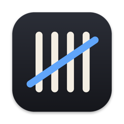
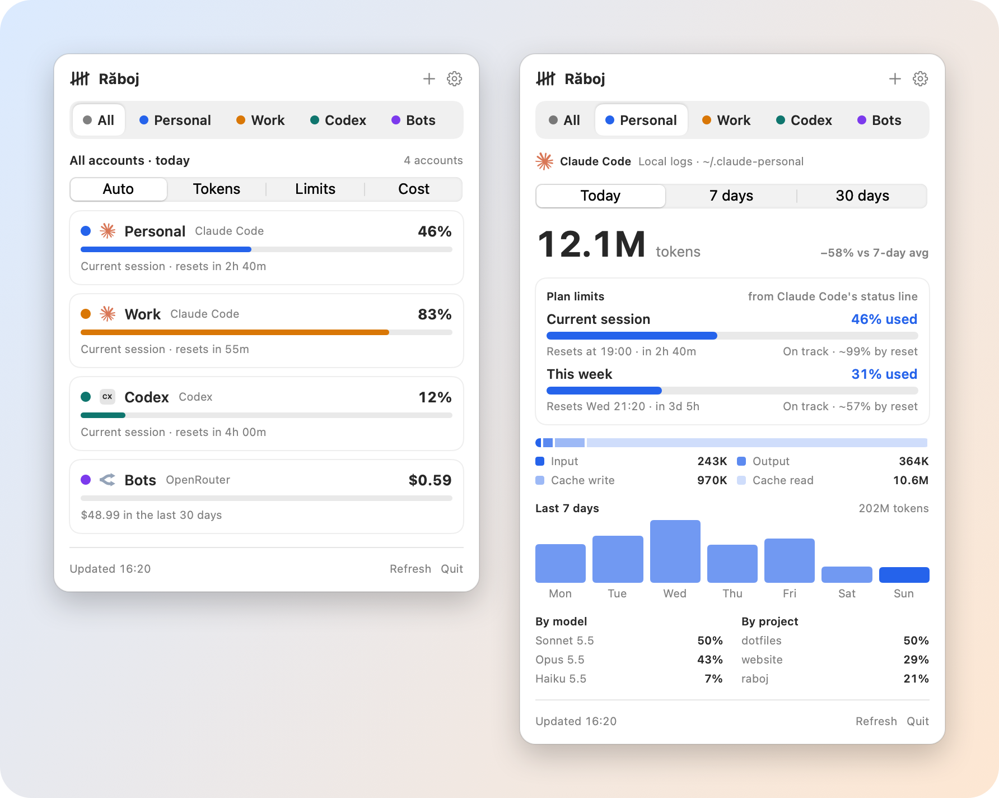
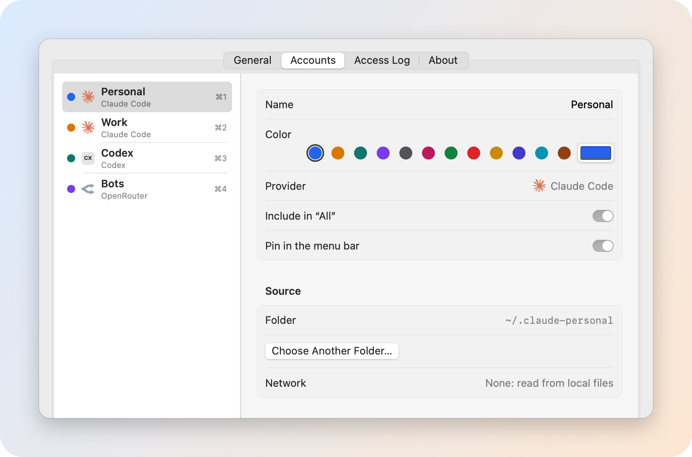

<div align="center">



# Răboj

**Your AI usage in the macOS menu bar. Every provider, every account, side by side.**

Claude Code · Codex · Gemini CLI · Anthropic · OpenAI · xAI · GitHub Copilot · Cursor · OpenRouter · DeepSeek

[](#install)
[](Package.swift)
[](LICENSE)
[](#privacy)
[](#support)
[](https://buymeacoffee.com/iampaulpop)

[Install](#install) · [Features](#features) · [Providers](#supported-providers) · [Privacy](#privacy) · [Setup](#setting-up-accounts) · [FAQ](#faq)

<br>

<picture>
  <source media="(prefers-color-scheme: dark)" srcset="docs/images/hero-dark.png">
  
</picture>

<sub>Screenshots use made-up demo data.</sub>

</div>

---

## Why Răboj?

If you use more than one AI tool, or more than one account, it's hard to know where you stand. Is the work account about to hit its 5-hour limit? How much did the API keys cost this week? Răboj puts the answer one glance away, in the menu bar, with each account in its own color.

> A *răboj* (pronounced *ruh-BOZH*) is the Romanian tally stick: a piece of wood shepherds and merchants notched to keep count. Răboj keeps count of your AI usage the same way.

## Features

<table>
<tr>
<td width="50%" valign="top">

### 🗂️ Every account, separately
Add as many accounts as you like, on any provider: a work and a personal Claude account, several API organizations, a Codex login. Each has its own name and color, and nothing is mixed up.

</td>
<td width="50%" valign="top">

### ⏱️ Plan limits, like `/usage`
See the **current session** and **weekly** limits for Claude and Codex, with the reset time, a countdown and a pace estimate: *on track*, or *limit around 18:40*.

</td>
</tr>
<tr>
<td valign="top">

### ⚡ Switch in a keystroke
<kbd>⌘</kbd><kbd>0</kbd> for All and <kbd>⌘</kbd><kbd>1</kbd> … <kbd>⌘</kbd><kbd>9</kbd> for each account. <kbd>⌥</kbd>-click the menu bar item to cycle, right-click for a menu. The popover stays put while you switch.

</td>
<td valign="top">

### 📊 The details when you want them
Today, 7 or 30 days. Change against your usual, a 7-day chart, the token split (input, output, cache), and breakdowns by model and project.

</td>
</tr>
<tr>
<td valign="top">

### 🎛️ Your menu bar, your choice
Show the selected account, or pin several accounts side by side. In All, pick what to compare: **Auto**, **Tokens**, **Limits**, **Cost** or **Requests**.

</td>
<td valign="top">

### 🔒 Private by design
No backend, no telemetry, no account. Sandboxed, read-only, and every network request is listed in the app. [More below](#privacy).

</td>
</tr>
</table>

<div align="center">

</div>

## Supported providers

| | Provider | Connect with | What you see |
|:-:|---|---|---|
| 💻 | **Claude Code** | Its data folder (`~/.claude`, or any `CLAUDE_CONFIG_DIR`) | Tokens by type, model and project · session and weekly plan limits ([setup](#claude-plan-limits)) |
| 💻 | **Codex** | Its data folder (`~/.codex`, or `CODEX_HOME`) | Tokens by model and project · plan limits |
| 💻 | **Gemini CLI** <sup>beta</sup> | Its data folder (`~/.gemini`) | Tokens by model and project |
| 🔑 | **Anthropic API** | Admin API key ([docs](https://platform.claude.com/docs/en/manage-claude/usage-cost-api)) | Billed cost, tokens by model |
| 🔑 | **OpenAI API** | Admin API key ([docs](https://developers.openai.com/api/reference/resources/admin/subresources/organization/subresources/usage)) | Billed cost, tokens by model |
| 🔑 | **xAI** <sup>beta</sup> | Management key + team ID ([docs](https://docs.x.ai/developers/rest-api-reference/management/billing)) | Billed cost per model |
| 🔑 | **GitHub Copilot** <sup>beta</sup> | Fine-grained token ([docs](https://docs.github.com/en/rest/billing/usage)) | Premium requests and cost per model |
| 🔑 | **Cursor** (Teams) <sup>beta</sup> | Team admin key ([docs](https://cursor.com/docs/account/teams/admin-api)) | Requests per day, on-demand spend |
| 🔑 | **OpenRouter** <sup>beta</sup> | API key ([docs](https://openrouter.ai/docs/api_reference/limits)) | Spend per day, key limit |
| 🔑 | **DeepSeek** <sup>beta</sup> | API key ([docs](https://api-docs.deepseek.com/api/get-user-balance/)) | Account balance |

💻 reads local files, no network · 🔑 calls the provider's official API · <sup>beta</sup> built from the official docs, not yet confirmed with a real account: [tell us](https://github.com/MIKALAKE/raboj/issues/new?template=provider.yml) if it works for you

Missing one? Providers need an official usage API or local logs. [Open an issue](https://github.com/MIKALAKE/raboj/issues) with a link to the docs.

## Install

> [!NOTE]
> Răboj is free and doesn't use a paid Apple Developer account, so builds are signed ad hoc, not notarized. Homebrew and source builds compile on your Mac, so macOS shows no warning. The DMG needs one extra click the first time.

### Homebrew (recommended)

```sh
brew install mikalake/tap/raboj
ln -sf "$(brew --prefix)/opt/raboj/Raboj.app" ~/Applications/Raboj.app
open ~/Applications/Raboj.app
```

### DMG

1. Download `Raboj-x.y.z.dmg` from [Releases](https://github.com/MIKALAKE/raboj/releases). Optionally check it: `shasum -a 256 -c Raboj-x.y.z.dmg.sha256`.
2. Drag **Răboj** to **Applications** and open it from there (not from the DMG window).
3. macOS says it can't verify the app. Click **Done**, open **System Settings › Privacy & Security**, and click **Open Anyway**. You only do this once.

<details>
<summary>Still blocked? (managed Macs)</summary>

On Macs managed by a company profile, **Open Anyway** may not stick. Remove the download quarantine flag instead:

```sh
xattr -dr com.apple.quarantine /Applications/Raboj.app
open /Applications/Raboj.app
```

If your organization blocks unsigned apps entirely, build from source (below) or ask your IT team.
</details>

### From source

```sh
xcode-select --install        # once, if you don't have the Command Line Tools
git clone https://github.com/MIKALAKE/raboj.git
cd raboj
make test install             # runs the tests, then installs to ~/Applications
open ~/Applications/Raboj.app
```

Requires macOS 14 Sonoma or later, on Apple Silicon or Intel.

## Setting up accounts

Click the tally icon in the menu bar, then **+**.

### Claude Code, Codex, Gemini CLI

Pick the provider and choose its data folder. The dialog opens in your home folder with hidden folders shown, so `~/.claude`, `~/.codex` and `~/.gemini` are right there.

Several Claude accounts through `CLAUDE_CONFIG_DIR` (say `~/.claude` for work and `~/.claude-personal` for you)? <kbd>⌘</kbd>-click both folders in the same dialog. Răboj creates one account per folder and suggests names.

### Claude plan limits

Claude Code doesn't write your plan limits to its logs, but it hands them to its [status line](https://code.claude.com/docs/en/statusline). Răboj uses that:

1. Open **Settings › Accounts**, select the Claude Code account.
2. Under **Session and weekly limits**, click **Copy Updated settings.json**, then **Open settings.json**, select all, paste and save. Your other settings are kept.
3. Send any message in Claude Code. The limits appear in Răboj.

<details>
<summary>Or add it by hand</summary>

Add this to the `settings.json` in that account's folder:

```json
{
  "statusLine": {
    "type": "command",
    "command": "f=\"${CLAUDE_CONFIG_DIR:-$HOME/.claude}/raboj-limits.json\"; cat > \"$f.tmp\" && mv \"$f.tmp\" \"$f\""
  }
}
```

It saves the numbers Claude Code passes to the status line into `raboj-limits.json`, next to your logs. It replaces any status line you already have.
</details>

### API keys

Pick the provider, paste the key, and click **Test Connection**. The help text in the dialog says which kind of key each provider needs and where to create it. Keys are stored in your macOS Keychain.

## Privacy

Răboj was built to be safe to run next to your work.

- **No backend, no telemetry, no analytics.** Răboj talks only to the providers you connect.
- **You connect each account yourself.** Nothing is read until you pick a folder or add a key.
- **Official and local sources only.** No scraping, no browser cookies, no reading other apps' logins.
- **Keys stay in your Keychain** and are sent only to that provider's API host, over HTTPS.
- **Every request is listed** in **Settings › Access Log**. Folder accounts never use the network.
- **Sandboxed:** outgoing connections and read-only access to the folders you pick, nothing else. `make verify` prints the exact permissions of a build.
- **Message content is never read.** Log parsers decode only token counts, models, timestamps and project names.

See [SECURITY.md](SECURITY.md) to report a vulnerability.

## FAQ

<details>
<summary><b>Why is the number in Răboj different from Claude's <code>/usage</code>?</b></summary>

The token counts come from the logs on this Mac, so they only include Claude Code on this Mac. Your plan limit also counts claude.ai, the desktop app and other devices. That's why the plan limits come straight from Claude Code (see [Claude plan limits](#claude-plan-limits)): with that set up, the session and weekly percentages match `/usage`.
</details>

<details>
<summary><b>Does Răboj send my data anywhere?</b></summary>

No. There is no Răboj server. Folder accounts are read locally. API accounts call only the provider you connected, and each call shows up in the Access Log.
</details>

<details>
<summary><b>Can I check the numbers myself?</b></summary>

Yes, the same parser runs from the command line:

```sh
swift run Raboj --report claude ~/.claude
swift run Raboj --report codex ~/.codex
```
</details>

<details>
<summary><b>How do I start it at login?</b></summary>

**Settings › General › Open Răboj at login.**
</details>

<details>
<summary><b>How do I uninstall it?</b></summary>

Quit Răboj, delete the app, and optionally remove `~/Library/Containers/io.github.mikalake.raboj` (your account list). API keys are in Keychain Access under "Răboj API key".
</details>

## Support

Răboj is free and open source, and it stays that way. If it saves you a surprise at the end of the month, you can buy me a coffee. ☕

<a href="https://buymeacoffee.com/iampaulpop"></a>

Bug reports, ideas and pull requests are just as welcome.

## Contributing

See [CONTRIBUTING.md](CONTRIBUTING.md). In short: SwiftPM with only the Command Line Tools, `make test`, PRs to `main`.

## License

[MIT](LICENSE) © 2026 Pop Paul

<div align="center">
<sub>Made in Romania 🇷🇴 · Provider logos from <a href="https://simpleicons.org">Simple Icons</a> (CC0)</sub>
</div>
